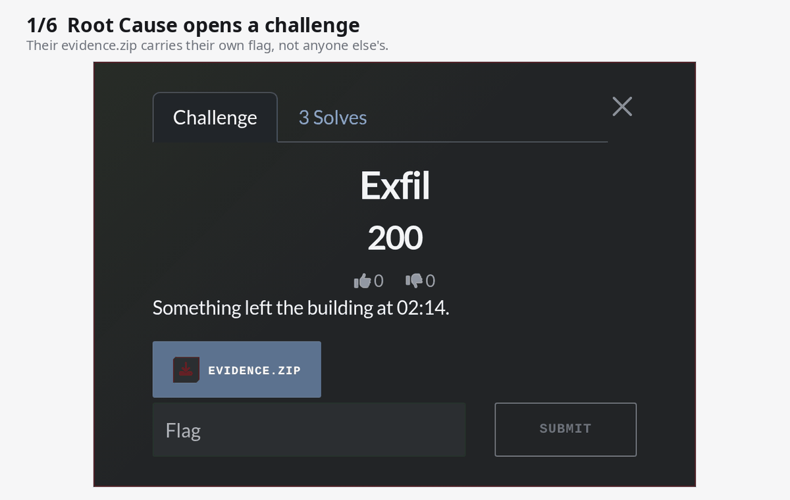
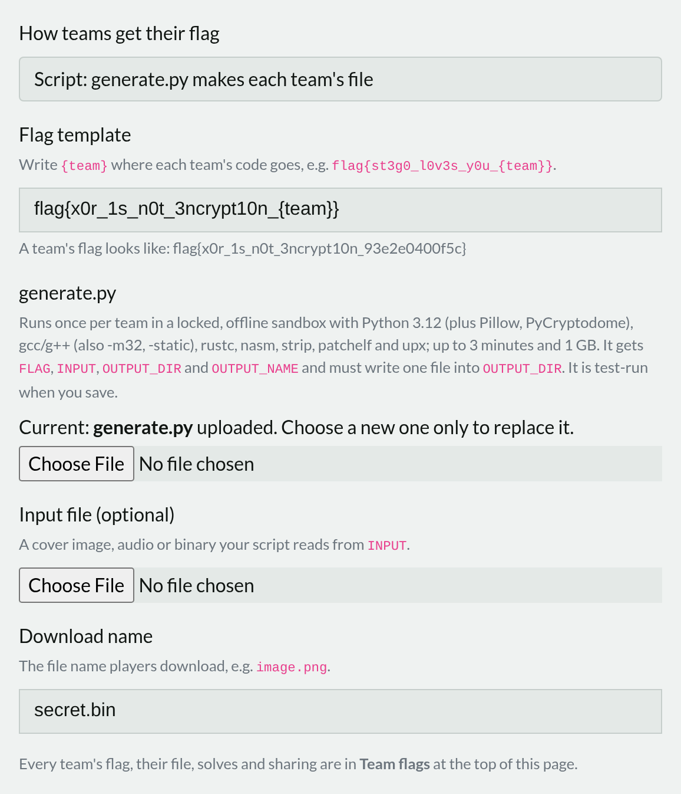
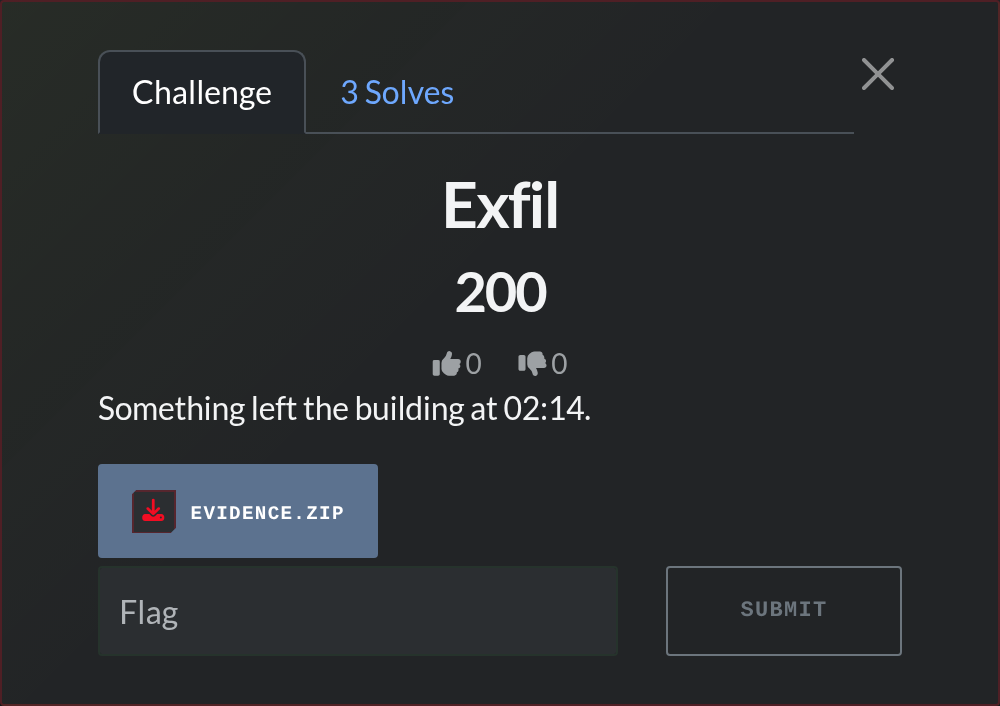
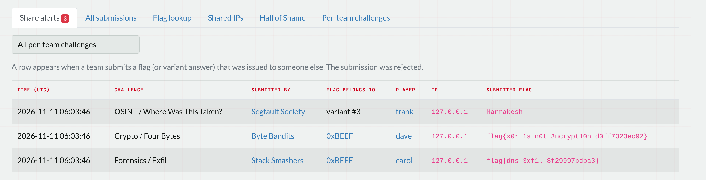
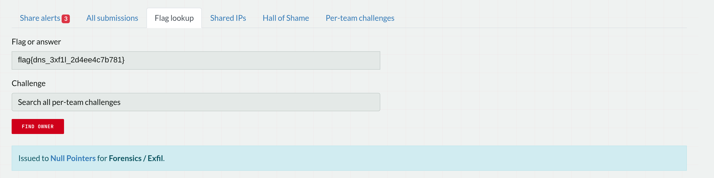
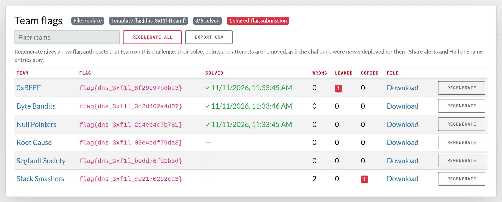
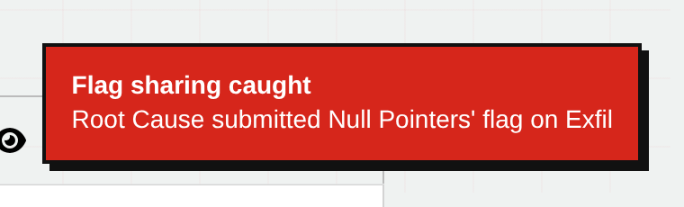

<p align="center">
  <picture>
    <source media="(prefers-color-scheme: dark)" srcset="docs/logo-dark.svg">
    
  </picture>
</p>

<p align="center"><b>Every team gets its own flag and its own files. A shared flag tells you who leaked it.</b></p>

<p align="center">
  <a href="https://github.com/rj-karan/ctfd-flagprint/actions/workflows/tests.yml"></a>
  
  <a href="LICENSE"></a>
  <a href="https://github.com/rj-karan/ctfd-flagprint/releases/latest"></a>
</p>

Flagprint is a [CTFd](https://github.com/CTFd/CTFd) plugin that stops flag sharing at its source. Each team gets a
flag nobody else has, often inside a file built just for them. When Team B submits Team A's flag, Team B only sees
"Incorrect". You see who copied it, whose flag it was, and when.

<p align="center"></p>

## Why

In any CTF with prizes, someone pastes a flag into a group chat. With a single static flag you never find out.
CTFd only offers per-user flags in its paid Enterprise edition, and only for hosted containers. Most challenges are
files: an image, a pcap, a binary, a zip. Flagprint gives those per-team flags too.

## What it does

- **Per-team flags.** Write a template like `flag{st3g0_l0v3s_y0u_{team}}`. Each team's `{team}` becomes a
  12-character code, an HMAC of the challenge and team under a secret kept in your database. No flag table to fill in,
  nothing to export and import.
- **Per-team files, of any kind.**
  - **Replace:** upload a file that contains a sample flag. Each team downloads a copy with their own flag in its
    place. Works on text, binaries and pcaps, and inside zip archives.
  - **Script:** upload a `generate.py`. It runs once per team in an offline, locked-down Docker sandbox and writes that
    team's file. Use it for stego images, compiled crackmes, encrypted blobs, anything you can script.
- **Variants** for challenges with a fixed answer (OSINT, trivia): each team gets one of several versions of the task.
  Submitting another version's answer counts as sharing.
- **Leak attribution.** A wrong submission that matches another team's flag is logged with both teams, the user, the
  IP and the time. A pop-up alerts every admin page live.
- **Admin monitor:** share alerts, every submission with "whose flag was this", a flag lookup, accounts sharing an IP,
  and a per-challenge **Team flags** panel listing each team's flag, file, solve and sharing count.
- **Regenerate** one team's flag, or everyone's, if a flag leaks. Their old flag stops working and their solve on that
  challenge is reset.
- **Hall of Shame** (optional, off by default): a public page listing caught teams, filled automatically or by hand.
- **Quiet by default.** The challenge type shows up as `classic` and players never see the flag template. Install the
  plugin under a neutral folder name and nothing a player can see mentions Flagprint.

## How it works

```
flag template      flag{st3g0_l0v3s_y0u_{team}}
team code          HMAC-SHA256(secret, "challenge_id:team_id")[:12]  ->  5f1c09a2be47
Team A's flag      flag{st3g0_l0v3s_y0u_5f1c09a2be47}
```

When a submission is wrong but fits the template, Flagprint checks the code against every team's. If it belongs to
someone else, that's a share: logged for you, "Incorrect" for them.

## Install

Clone it into CTFd's plugins folder and restart CTFd:

```bash
cd CTFd/CTFd/plugins
git clone https://github.com/rj-karan/ctfd-flagprint flagprint
```

The plugin creates its tables on startup. Open **Admin → Flagprint**, then create a challenge of type **classic**.

**Script delivery** also needs Docker on the CTFd host:

```bash
pip install -r CTFd/plugins/flagprint/requirements.txt      # the Python docker client
docker build -t flagprint/generator:latest CTFd/plugins/flagprint/generator
```

The sandbox image has Python 3.12 with Pillow and PyCryptodome, gcc/g++ (including `-m32` and static musl builds),
rustc, nasm, binutils, patchelf and upx. Without it, scripts run in plain `python:3.12-slim`. To use another image, set
`FLAGPRINT_SANDBOX_IMAGE`.

With CTFd's `docker-compose.yml`, mount the Docker socket into the `ctfd` service and give it the socket's group:

```yaml
services:
  ctfd:
    group_add:
      - "${DOCKER_GID}"        # getent group docker | cut -d: -f3
    volumes:
      - /var/run/docker.sock:/var/run/docker.sock
```

CTFd's Dockerfile installs each plugin's `requirements.txt` when the image is built, so rebuild it after cloning.

> **Mounting the Docker socket gives CTFd control of the host's Docker.** Only Flagprint's script delivery needs it.
> If you only use flag, replace or variants delivery, skip it.

### Hide it from players

Asset paths follow the folder name, and players can see those paths in the challenge API. Clone into a neutral name
to keep the plugin invisible, so sharers get caught instead of warned:

```bash
git clone https://github.com/rj-karan/ctfd-flagprint classic
```

Or name it openly and use it as a deterrent. Both work.

## Create a per-team challenge

1. **Admin → Challenges → New → classic.**
2. Pick how teams get their flag:

   | Delivery | Use it for | What you upload |
   |---|---|---|
   | Replace | Files that hold the flag as-is: text, pcap, binary, zip | The file, containing the sample flag shown under the template |
   | Script | Files that must be built: stego, crackmes, encrypted data | `generate.py`, plus an optional input file |
   | Flag only | Services or instances that show the flag themselves | Nothing |
   | Variants | Fixed answers: OSINT, trivia | Two or more task texts with their answers |

3. Write the flag template with `{team}` exactly once, e.g. `flag{n0t_y0ur_fl4g_{team}}`.
4. Save. Script delivery test-runs your script before anything is saved, so a broken script never reaches players.



Players download their file from the challenge window as usual:



### Writing generate.py

Your script gets these environment variables and must write one file into `OUTPUT_DIR`:

| Variable | Value |
|---|---|
| `FLAG` | This team's flag |
| `INPUT` | Path of the optional input file, or empty |
| `OUTPUT_DIR` | Folder to write the result into |
| `OUTPUT_NAME` | The download name you chose, e.g. `image.png` |

It runs with no network, all capabilities dropped, 1 GB of memory and a 3-minute limit. Each team's file is built on
their first download and cached. Two complete examples:

- [`examples/stego_png.py`](examples/stego_png.py): hides the flag in the low bits of a cover image
- [`examples/rev_binary.py`](examples/rev_binary.py): compiles a crackme with the flag XOR-encoded inside

## Admin monitor



**Admin → Flagprint** has:

- **Share alerts:** every time a team submitted another team's flag
- **All submissions:** to per-team challenges, with whose flag each one was
- **Flag lookup:** paste a flag from a writeup or a Discord screenshot and see which team it was issued to
- **Shared IPs:** IPs used by more than one team
- **Hall of Shame:** turn the public page on or off, auto-add caught teams, add or hide entries by hand
- **Per-team challenges:** every challenge using per-team flags



Each per-team challenge's admin page also gets a **Team flags** panel: every team's flag, a download of their exact
file, solve status, how often their flag leaked or they used someone else's, and **Regenerate**.



New shares pop up on every admin page while you work:



## Works with other plugins

Plugins that issue their own per-team flags, such as a container instancer, can join the monitor, flag lookup and
share logging:

```python
from CTFd.plugins.flagprint import ON_REGENERATE, PER_TEAM_SOURCES, TEAM_FLAG_EXTRAS, record_if_shared
from CTFd.plugins.flagprint.flags import classify, flag_for

# Your challenge model needs flag_template (with {team}) and delivery = "flag".
PER_TEAM_SOURCES.append(lambda: MyContainerChallenge.query.all())
TEAM_FLAG_EXTRAS.append(lambda challenge, account_ids: {})  # extra columns for the Team flags panel
ON_REGENERATE.append(lambda challenge, account_ids: None)   # e.g. stop instances holding the old flag

# Give each instance flag_for(challenge, account_id), check answers with classify(...),
# and call record_if_shared(user, team, challenge, request) from your challenge type's fail().
```

For behaviour signals Flagprint doesn't cover (bots, AI agents, shared accounts, solve speed), it pairs well with
[ctfd-warden](https://github.com/0xZyyz/ctfd-warden), which detects sharing but needs unique flags from elsewhere.

## Limits

Flagprint catches **flags** that move between teams. It can't stop a team from sharing a writeup or a solve script
that each team then runs on its own file. For that, make the per-team files differ in more than the flag: a random
key, offset or layout in `generate.py`.

## Compatibility

CTFd 3.8.x, in teams mode and users mode. Used in production on MariaDB; tests run on SQLite. PostgreSQL should work but is untested. Tested in CI against CTFd 3.8.7 and
3.8.9.

## Development

```bash
git clone https://github.com/CTFd/CTFd && cd CTFd
pip install -r requirements.txt pytest docker
git clone https://github.com/rj-karan/ctfd-flagprint CTFd/plugins/flagprint
mkdir tests/flagprint && touch tests/flagprint/__init__.py
cp CTFd/plugins/flagprint/tests/test_flagprint.py tests/flagprint/
python -m pytest tests/flagprint -p no:randomly
```

Tests that run `generate.py` need Docker and are skipped without it.

Bug reports and pull requests are welcome.

## Support

If Flagprint helped your event, star the repo so other organizers can find it, and tell us how it went in
[Discussions](https://github.com/rj-karan/ctfd-flagprint/discussions) or an issue.

## License

[Apache 2.0](LICENSE). Copyright 2026 [KARAN RJ](https://github.com/rj-karan).
